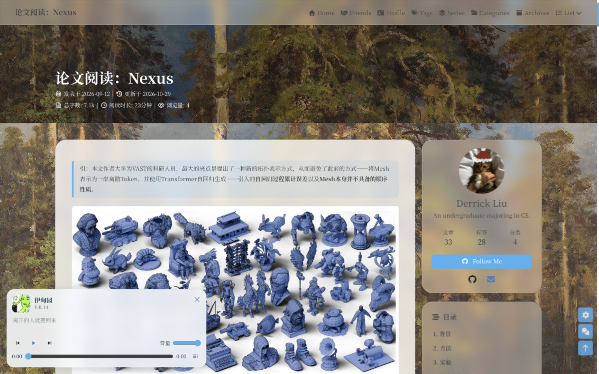
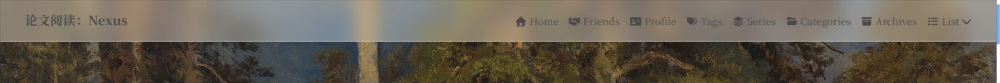

# hexo-theme-liquid

**简体中文** | [English](README_EN.md)

一个独立的 Hexo 个人主题：玻璃卡片、系列页、音乐播放器和访问统计都收在主题内部，不依赖站点私有脚本或样式。



顶部固定导航的磨砂效果：



> 截图来自作者博客，实际效果取决于背景、头像、字体和颜色配置。

## 特性

- **配置集中**：`nav`、`menu`、`aside`、`comments`、`CDN` 等常用配置保留，新增功能集中在 `liquid:` 段。
- **玻璃卡片**：CSS `backdrop-filter` + Chromium SVG 折射，近似液态玻璃外观；参数全部是 CSS 变量。
- **系列 / 专栏页**：根据文章 front-matter 的 `series` 自动生成专栏目录和文章列表。
- **音乐页与全局播放器**：播放器、歌词、歌单渲染都在主题内，歌单地址可配置。
- **访问统计**：兼容不蒜子接口，可替换 API 地址。
- **子路径兼容**：主题资源、系列页、音乐页、统计请求都通过 `url_for` 或 `GLOBAL_CONFIG.root` 生成，部署在 `/blog/` 等子目录也能用。
- **可选站点资源**：`liquid.assets.css/js` 可以追加站点自己的样式和脚本，不需要改主题源码。

## 安装

把主题放到 Hexo 站点的 `themes/liquid`：

```sh
cd your-hexo-site
git clone https://github.com/ziyuliu258/hexo-theme-liquid.git themes/liquid
```

在站点 `_config.yml` 中设置：

```yaml
theme: liquid
```

安装主题依赖：

```sh
npm install hexo-renderer-pug hexo-renderer-stylus cheerio hexo-front-matter katex
```

或者：

```sh
cd themes/liquid && npm install
cd ../..
npm install hexo-renderer-pug hexo-renderer-stylus
```

然后把主题的 `_config.yml` 复制到站点根目录，命名为 `_config.liquid.yml`，只保留需要覆盖的配置。Hexo 会自动读取 `_config.<theme>.yml`。

```sh
cp themes/liquid/_config.yml _config.liquid.yml
```

## 基本配置

新增配置在 `_config.liquid.yml` 的 `liquid:` 段：

```yaml
liquid:
  enable: true

  glass:
    enable: true          # 是否加载玻璃折射脚本
    refraction: true      # 仅桌面 Chromium 生效；其他浏览器回退到 CSS 玻璃

  aside_motion:
    enable: true          # 单双栏切换时侧栏文字浮现动画

  announcement:
    enable: true
    title:                # 留空使用语言文件里的“公告”
    content: 欢迎来到我的博客！   # 支持 HTML；为空时不显示公告

  series:
    enable: true
    path: series/         # 专栏总览：/series/
    item_path: series/    # 单个专栏：/series/<slug>/
    title:                # 留空使用语言文件里的“专栏”
    more_text:            # 留空使用语言文件里的“查看全部专栏”

  music:
    enable: true
    page_path: music/                 # 播放器标题点击后去的页面
    playlist_path: music/playlist.json
    sync:
      enable: false                   # 可选：生成前运行下面的脚本
      script: tools/sync-music-playlist.py
      playlist_id:                    # 可选：覆盖歌单 ID

  statistics:
    enable: true
    provider: busuanzi
    api: https://your-busuanzi.example.com/api
    site_uv: true
    site_pv: true
    page_pv: true
    note:                             # 统计数字的鼠标提示

  comments:
    giscus:
      loading_text:        # 留空使用语言文件
      error_text:
      retry_text:

  background:
    avif: /images/background.avif   # 可选：同一背景的 AVIF 版本
    preload: true

  assets:
    css: []                # 站点自己的 CSS，例如 [css/site.css]
    js: []                 # 站点自己的 JS
```

### 导航菜单

主题默认 `menu: null`，不会带入示例菜单。站点在 `_config.liquid.yml` 中写完整菜单即可，顺序就是显示顺序：

```yaml
menu:
  Home: / || fas fa-home
  Friends: /link/ || fas fa-handshake
  Series: /series/ || fas fa-layer-group
```

### 系列 / 专栏

在文章 front-matter 增加：

```yaml
series: 西安交通大学-计算机系统导论实验
```

主题会自动生成：

- `/series/`：专栏总览
- `/series/<slug>/`：该专栏的文章列表

路径可以通过 `liquid.series.path` 和 `liquid.series.item_path` 修改。

### 音乐播放器

音乐页需要站点提供 `source/music/index.md`（front-matter 写 `type: music` 即可，界面由主题渲染）和 `source/music/playlist.json`。播放器读取的字段：

- `name`：歌单名
- `url`：网易云歌单地址
- `tracks[]`：`id`、`name`、`artist`、`cover`、`available`、`preview`、`lyric`

主题只负责播放和渲染，不绑定具体歌单。`liquid.music.sync.enable` 打开时，生成前会运行配置里的 Python 脚本刷新歌单文件；脚本不存在或网络失败只会告警，不会阻止生成。

### 访问统计

`liquid.statistics.api` 填兼容 [soxft/busuanzi](https://github.com/soxft/busuanzi) 的接口地址。旧的 `busuanzi:` 配置仍会作为兼容回退读取：

```yaml
busuanzi:
  site_uv: true
  site_pv: true
  page_pv: true
  api: https://your-busuanzi.example.com/api
```

### 图片路径

主题不改变 Hexo 的图片处理方式，以下写法都保留：

1. **全站公共图片**：`/images/foo.png` 或 `images/foo.png`
2. **文章资源目录**：`post_asset_folder: true` 时，`文章名/foo.png`
3. **已带 `root` 的站内绝对路径**：`/blog/posts/xxxx/foo.png`
4. **完整外链**：`https://...`
5. **颜色 / CSS 背景**：`background: "#f5f5f5"` 等

主题内所有资源引用都经过 `url_for`；文章附件和公共图片的改写由站点自己的 `hexo-asset-image` 配置负责，不需要改 Markdown 原文。`getBgPath()` 也兼容“已带 root”和“未带 root”两种站内路径。

### 目录

侧栏目录的层级编号可以关掉，也可以按文章单独设置：

```yaml
toc:
  post: true                        # 文章页显示目录
  page: false                       # 独立页面显示目录
  number: true                      # 是否显示 1. / 1.1. 这样的层级编号
  expand: false                     # 是否默认展开全部层级
  scroll_percent: false             # 目录顶部是否显示阅读进度
```

单篇文章在 front-matter 里覆盖全局设置：

```yaml
---
toc: false          # 这篇不显示目录
toc_number: false   # 这篇不显示层级编号
toc_expand: true    # 这篇默认展开
---
```

目录里的标题跳转依赖标题的 `id`。`hexo-renderer-markdown-it` 默认只给 h2 及更深的标题生成 `id`，所以用 `# 一级标题` 写章节的站点需要在 `_config.yml` 放开：

```yaml
markdown:
  anchors:
    level: 1
```

### 图片查看器

`lightbox: viewer` 启用主题内置的图片查看器，不依赖 CDN，也不加载第三方库：

```yaml
lightbox: viewer
```

点击正文图片打开全屏界面，支持滚轮 / 按钮 / 双击缩放，放大后拖动平移，触屏双指捏合，`←` `→` 切换上下张，下载原图，`Esc`、点背景或右上角关闭。目录里的图片只在文章容器内接管；包在链接里的图片（`[](url)`）不拦截，仍按原链接跳转，给图片加 `no-viewer` 类也可以跳过。

其它可选值：`fancybox` / `medium_zoom`，需要自行提供 `fancybox`、`fancybox_css`、`medium_zoom` 对应的资源；留空则关闭点击放大。

### 自定义外观

`source/css/liquid.css` 是 Liquid 的外观层，核心样式不动。玻璃参数在文件开头：

```css
:root {
  --glass-tint: rgba(255, 255, 255, 0.36);
  --glass-blur: 14px;
  --glass-radius: 26px;
  --glass-refract-thickness: 35;
  --glass-refract-ior: 1.70;
}
```

深色模式参数在 `[data-theme='dark']` 中。站点级别的小改动优先放到 `liquid.assets.css`，不要直接改主题。

## 目录结构

```text
themes/liquid/
├── _config.yml                 # 完整默认配置
├── layout/                     # Pug 模板
│   ├── series.pug              # 专栏页
│   ├── includes/page/music.pug # 音乐页界面
│   └── includes/...            # 主题模板和 Liquid 接入点
├── scripts/
│   ├── common/config.js        # 配置归一化
│   ├── common/title-math.js    # 标题公式渲染
│   ├── events/                 # 配置、KaTeX、标题、音乐同步
│   ├── generators/series.js    # 专栏生成器
│   └── helpers/liquid.js       # 模板 helper
├── source/
│   ├── css/liquid.css          # Liquid 外观层
│   ├── js/                     # 玻璃、侧栏动画、统计、播放器
│   └── vendor/extsrc/          # 内置的可选第三方效果资源
└── languages/                  # 中英文文案
```

## 开发

```sh
# 在 Hexo 站点根目录
hexo clean && hexo generate
hexo server
```

主题不需要构建步骤：Pug 和 Stylus 由 Hexo 渲染器处理，`source/` 下的静态文件直接复制到站点。

## 许可证

本主题以 Apache-2.0 发布。完整许可证见 [LICENSE](LICENSE)，版权与第三方声明见 [NOTICE.md](NOTICE.md)。

## 已知边界

- 玻璃折射依赖 Chromium 的 `backdrop-filter: url(...)`；Firefox/Safari 使用纯 CSS 玻璃回退。
- 音乐播放依赖网易云外链播放接口，能否收听取决于访问者网络和版权地区。
- 统计服务是第三方接口，历史数据不会自动迁移。
