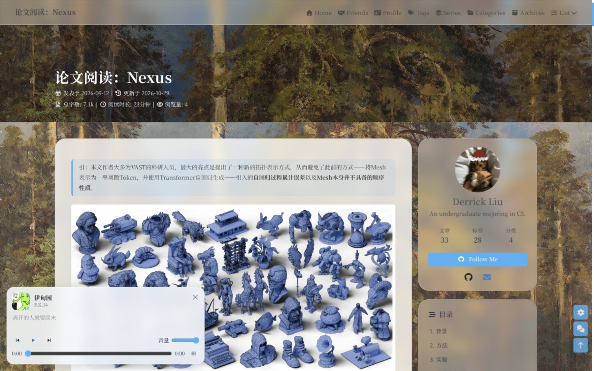
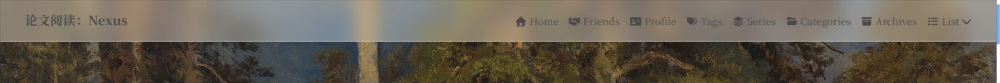

# hexo-theme-liquid

English | **[简体中文](README.md)**

A standalone Hexo personal theme: liquid-glass cards, series pages, a music player, and visitor statistics live inside the theme. No site-private scripts or styles are required.



The frosted fixed navigation bar:



> Screenshots are from the author's blog. The result depends on the configured background, avatar, fonts, and colors.

## Features

- **Centralized configuration**: common options such as `nav`, `menu`, `aside`, `comments`, and `CDN` are preserved, while new features live under `liquid:`.
- **Liquid glass cards**: CSS `backdrop-filter` plus Chromium SVG refraction for a close approximation of liquid glass. All optics are CSS variables.
- **Series pages**: generates a series index and one reading list per series from the `series` front-matter field.
- **Music page and global player**: player, lyrics, and playlist rendering are bundled with the theme; the playlist URL is configurable.
- **Visitor statistics**: supports Busuanzi-compatible APIs and a custom endpoint.
- **Sub-directory ready**: theme assets, series pages, the music page, and statistics requests use `url_for` or `GLOBAL_CONFIG.root`, so deployments under `/blog/` keep working.
- **Optional site assets**: add site-specific CSS or JavaScript through `liquid.assets.css/js` without editing the theme.

## Install

Place the theme in your Hexo site's `themes/liquid` directory:

```sh
cd your-hexo-site
git clone https://github.com/ziyuliu258/hexo-theme-liquid.git themes/liquid
```

Set the theme in your site `_config.yml`:

```yaml
theme: liquid
```

Install the theme dependencies:

```sh
npm install hexo-renderer-pug hexo-renderer-stylus cheerio hexo-front-matter katex
```

Or:

```sh
cd themes/liquid && npm install
cd ../..
npm install hexo-renderer-pug hexo-renderer-stylus
```

Copy the theme's `_config.yml` to the site root as `_config.liquid.yml` and keep only the overrides you need. Hexo reads `_config.<theme>.yml` automatically.

```sh
cp themes/liquid/_config.yml _config.liquid.yml
```

## Configuration

New options live under `liquid:` in `_config.liquid.yml`:

```yaml
liquid:
  enable: true

  glass:
    enable: true          # load the refraction script
    refraction: true      # desktop Chromium only; other browsers fall back to CSS glass

  aside_motion:
    enable: true          # fade the aside content when switching columns

  announcement:
    enable: true
    title:                # empty uses the language file
    content: Welcome to my blog!   # supports HTML; empty hides the card

  series:
    enable: true
    path: series/         # series index: /series/
    item_path: series/    # one series: /series/<slug>/
    title:                # empty uses the language file
    more_text:            # empty uses the language file

  music:
    enable: true
    page_path: music/                 # dock title target
    playlist_path: music/playlist.json
    sync:
      enable: false                   # optional: run the script before generation
      script: tools/sync-music-playlist.py
      playlist_id:                    # optional playlist ID override

  statistics:
    enable: true
    provider: busuanzi
    api: https://your-busuanzi.example.com/api
    site_uv: true
    site_pv: true
    page_pv: true
    note:                             # tooltip for the numbers

  comments:
    giscus:
      loading_text:        # empty uses the language file
      error_text:
      retry_text:

  background:
    avif: /images/background.avif   # optional AVIF version of the same background
    preload: true

  assets:
    css: []                # site CSS, for example [css/site.css]
    js: []                 # site JavaScript
```

### Navigation menu

The theme defaults to `menu: null` and does not inject a demo menu. Define the full menu in `_config.liquid.yml`; the order is the display order:

```yaml
menu:
  Home: / || fas fa-home
  Friends: /link/ || fas fa-handshake
  Series: /series/ || fas fa-layer-group
```

### Series

Add the series name to a post's front-matter:

```yaml
series: XJTU-ICS-Labs
```

The theme generates:

- `/series/`: series index
- `/series/<slug>/`: reading list for that series

Change the paths with `liquid.series.path` and `liquid.series.item_path`.

### Music player

The site provides `source/music/index.md` (front-matter `type: music`; the theme renders the UI) and `source/music/playlist.json`. The player reads:

- `name`: playlist name
- `url`: NetEase Cloud Music playlist URL
- `tracks[]`: `id`, `name`, `artist`, `cover`, `available`, `preview`, `lyric`

The theme only renders and plays the playlist; it does not hard-code a playlist. When `liquid.music.sync.enable` is on, the configured Python script runs before generation. A missing script or network failure only logs a warning and does not block generation.

### Visitor statistics

Set `liquid.statistics.api` to a [soxft/busuanzi](https://github.com/soxft/busuanzi)-compatible endpoint. The legacy `busuanzi:` section is still read as a fallback:

```yaml
busuanzi:
  site_uv: true
  site_pv: true
  page_pv: true
  api: https://your-busuanzi.example.com/api
```

### Image paths

The theme does not change Hexo's image handling. These forms keep working:

1. **Shared images**: `/images/foo.png` or `images/foo.png`
2. **Post asset folder**: with `post_asset_folder: true`, `post-name/foo.png`
3. **Root-prefixed absolute path**: `/blog/posts/xxxx/foo.png`
4. **Remote URL**: `https://...`
5. **Color / CSS background**: `background: "#f5f5f5"`

Every theme asset goes through `url_for`. Post attachments and shared images are rewritten by the site's own `hexo-asset-image` setup; Markdown does not need to change. `getBgPath()` also accepts both root-prefixed and unprefixed internal paths.

### Appearance

`source/css/liquid.css` is the Liquid appearance layer; the core theme styles stay untouched. The glass parameters are at the top of the file:

```css
:root {
  --glass-tint: rgba(255, 255, 255, 0.36);
  --glass-blur: 14px;
  --glass-radius: 26px;
  --glass-refract-thickness: 35;
  --glass-refract-ior: 1.70;
}
```

Dark-mode values live under `[data-theme='dark']`. Prefer `liquid.assets.css` for site-level changes instead of editing the theme.

## Directory structure

```text
themes/liquid/
├── _config.yml                 # complete default configuration
├── layout/                     # Pug templates
│   ├── series.pug              # series pages
│   ├── includes/page/music.pug # music page UI
│   └── includes/...            # theme templates and Liquid integration
├── scripts/
│   ├── common/config.js        # config normalization
│   ├── common/title-math.js    # math in titles
│   ├── events/                 # config, KaTeX, titles, music sync
│   ├── generators/series.js    # series generator
│   └── helpers/liquid.js       # template helpers
├── source/
│   ├── css/liquid.css          # Liquid appearance layer
│   ├── js/                     # glass, aside motion, statistics, player
│   └── vendor/extsrc/          # bundled optional effect assets
└── languages/                  # Chinese and English strings
```

## Development

```sh
# from the Hexo site root
hexo clean && hexo generate
hexo server
```

There is no build step: Pug and Stylus are handled by the Hexo renderers, and files under `source/` are copied to the site directly.

## License

Released under Apache-2.0. See [LICENSE](LICENSE) for the full text and [NOTICE.md](NOTICE.md) for copyright and third-party notices.

## Known limitations

- Glass refraction requires Chromium's `backdrop-filter: url(...)`; Firefox and Safari use the CSS-only glass fallback.
- Music playback depends on NetEase Cloud Music's external playback endpoint; availability depends on the visitor's network and region.
- Visitor statistics are provided by a third-party endpoint; historical data is not migrated automatically.
